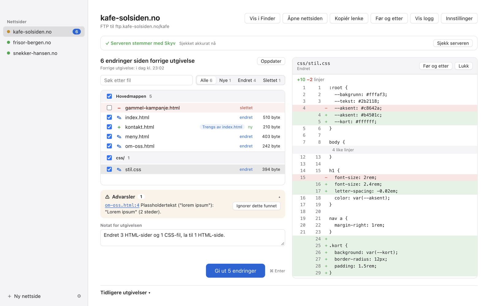
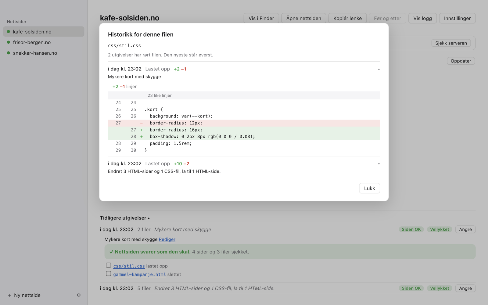
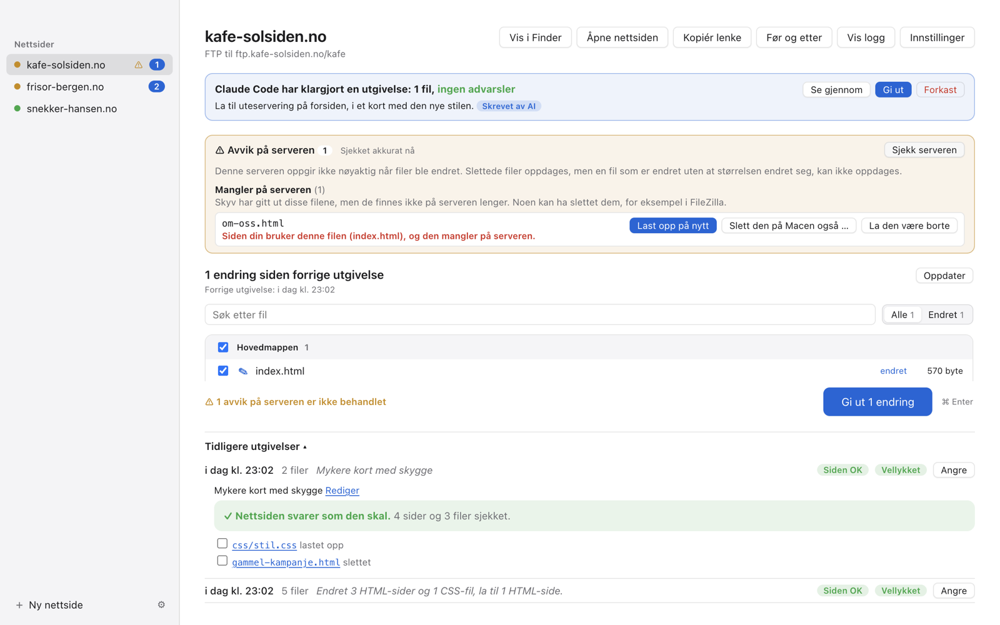
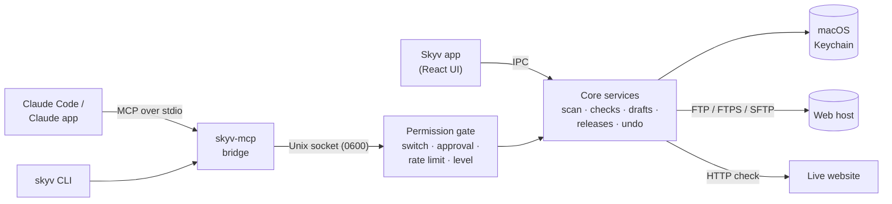

<div align="center">


# Skyv

**Publish website changes as releases, not files.**

A macOS app for FTP, FTPS and SFTP that checks your changes before they go live, verifies the live site afterwards, and lets you undo any release with one click.

[](https://github.com/PolsaFH/skyv/releases/latest)


[](LICENSE.md)

[**Download for Mac**](https://github.com/PolsaFH/skyv/releases/latest) &nbsp;·&nbsp; [Features](#features) &nbsp;·&nbsp; [AI connection](#work-with-ai-safely) &nbsp;·&nbsp; [Architecture](#under-the-hood) &nbsp;·&nbsp; [🇳🇴 Norsk](README.no.md)

<br>



</div>

<br>

## Why Skyv

Classic FTP clients copy files. You have to remember what you changed, nothing stops you from overwriting someone else's work, and there is no way back if the site breaks.

Skyv treats the folder on your Mac as the source of truth and the web server as a place you *release* to. Every release is checked, backed up, verified and reversible.

It is built for people who make websites (HTML, CSS, JavaScript or PHP), often together with an AI assistant, and who want the safety of a deployment pipeline without learning git.

> **Note:** the app interface is in Norwegian (bokmål). This README is in English, and there is a [Norwegian version](README.no.md).

<br>

## Features

### See exactly what will change
Skyv watches your site folders and lists what is new, changed, deleted or renamed since the last release. You get line-by-line differences for text and before/after views for images. It also finds files your pages depend on and includes them automatically, so you never publish a page with a missing stylesheet.

### Catch mistakes before they go live
Every release runs through a set of checks. Serious problems block the release until you fix them or explicitly accept the risk.

| Check | What it catches |
|---|---|
| Secrets | API keys, passwords and private keys in your code |
| Sensitive files | `.env` files, SSH keys, certificates, database dumps, backups and archives that should never be public |
| Broken references | Links to files that will be missing, and links to `localhost` or local network addresses |
| PHP | Syntax errors, using the PHP installed on your Mac |
| Content | Leftover placeholder text such as *lorem ipsum*, and invalid JSON |
| Conflicts | Files that someone else changed on the server since your last release |

### Publish safely
- **Backup first:** every file that will be overwritten or deleted is downloaded before anything changes.
- **No half-written files:** uploads go to a temporary name and are renamed into place when complete.
- **Parallel and resilient:** several connections at once, automatic retries, and safe resume after a crash or power loss.
- **Deletions are never automatic:** they are opt-in, every time.

### Verify the live site, and undo with one click
After each upload Skyv loads the affected pages from your real web address. It checks that they respond, show no PHP errors, and that their images, CSS and JavaScript load. If something is wrong you can undo the whole release, or only selected files. You can also let Skyv undo automatically.

### Notice when the server drifts
**Check the server** compares the server with what Skyv last published and lists three kinds of drift:
- files that are **missing** on the server
- files that were **changed** there
- files that exist **only on the server**

Each one comes with a clear choice: upload again, fetch the server version, keep yours, or leave it. Anything removed on your Mac goes to the Trash, never deleted for good.

### History for every file
Each release stores a compact line difference per text file. Open any file to see when it changed, in which release, with which note, and exactly what changed.

<br>

<div align="center">

</div>

<br>

## Work with AI, safely

Skyv includes a local [Model Context Protocol](https://modelcontextprotocol.io) server. With it, **Claude Code** or the **Claude app** can see your sites, run the checks, take screenshots of pages and prepare releases. No API key is needed, and you stay in control.

<div align="center">
<picture>
  <source media="(prefers-color-scheme: dark)" srcset="docs/images/ai-dark.png">
  
</picture>
</div>

<br>

- **Off by default**, with a main switch, and every new AI client must be approved in the app.
- **Three permission levels per site:** *view*, *view and prepare*, or *view, prepare and publish*.
- **Drafts, not surprises:** the AI prepares a release with a note. It shows up as a banner in Skyv, marked *Written by AI*, and you publish it with one click.
- **Hard stops the AI cannot bypass**, even at the highest level:
  - blocking findings
  - server conflicts
  - unhandled server drift
  - deletions
  - files changed after the draft was made
- **Never undoes on its own:** the AI can only *ask* you to undo a release.
- **Secrets stay secret:**
  - Passwords are never sent to the AI.
  - Lines that look like keys are masked.
  - Every reply is scrubbed for known passwords.
  - File and page content is marked as data, not instructions, to resist prompt injection.
- **Closes the loop:** if the live-site check fails after an AI release, the AI gets the failing page, file and error, so it can fix the problem and prepare a new release.

One command connects Claude Code:

```bash
claude mcp add skyv -- /Applications/Skyv.app/Contents/Resources/bin/skyv-mcp
```

Then ask things like:
- *"What has changed on the website?"*
- *"Run the checks and fix what you can."*
- *"When was stil.css last changed?"*
- *"Prepare a release with a short note."*

There is also a `skyv` command for the terminal (`skyv status`, `skyv check`, `skyv prepare`), with the same permissions.

<br>

## Under the hood



**How a release flows:**
1. scan
2. dependency resolution
3. checks
4. conflict check
5. backup
6. upload to temporary names
7. rename into place
8. live-site verification
9. automatic undo (optional)

| | |
|---|---|
| **Stack** | Electron 45, React 19, TypeScript (strict), Vite, electron-vite |
| **Transfer** | `basic-ftp` (FTP/FTPS), `ssh2-sftp-client` (SFTP) |
| **AI** | `@modelcontextprotocol/sdk`, Zod schemas, local Unix socket API |
| **Storage** | Atomic JSON writes, content-addressed copies, passwords encrypted with the macOS Keychain |
| **Design** | Core logic in `src/core` is plain TypeScript with no Electron imports. The UI, the AI connection and the CLI all go through the same services, so the same rules apply everywhere. |
| **Tests** | 274 tests with Vitest: unit tests, integration tests against a local FTP server, and end-to-end tests that drive the real app with Playwright |
| **Performance** | 5,000 files: first scan about 0.8 s, rescan about 0.55 s, pre-release checks about 0.4 s (Apple silicon) |

More on architecture, design decisions and known limitations is in [`docs/UTVIKLING.md`](docs/UTVIKLING.md) (Norwegian).

<br>

## Install

1. Download `Skyv-<version>-arm64.dmg` (Apple silicon) or `Skyv-<version>-x64.dmg` (Intel) from [Releases](https://github.com/PolsaFH/skyv/releases/latest).
2. Open the `.dmg` and drag Skyv to **Applications**.
3. Open Skyv and dismiss the warning. The app is not notarized by Apple.
4. Go to **System Settings → Privacy & Security** and click **Open Anyway**.

Optional: install PHP (`brew install php`) to enable PHP syntax checks and local preview of PHP pages.

### Build from source

```bash
npm install
npm run dev     # run in development
npm test        # run the test suite
npm run dist    # build .dmg files for Apple silicon and Intel
```

Requires Node 20 or later.

<br>

## Privacy

Skyv has no account, no telemetry and no server of its own. Everything stays on your Mac:
- Site settings, history and backups are stored in `~/Library/Application Support/Skyv`.
- Passwords are encrypted with the macOS Keychain.
- The AI connection is local and stays off unless you turn it on.

## License

Copyright © 2026 Filip Hjelmeland.

Skyv is free for noncommercial use under the [PolyForm Noncommercial License 1.0.0](LICENSE.md). You may use the app, and read and modify the code for noncommercial purposes. Commercial use requires written permission. Provided as is, without warranty.
