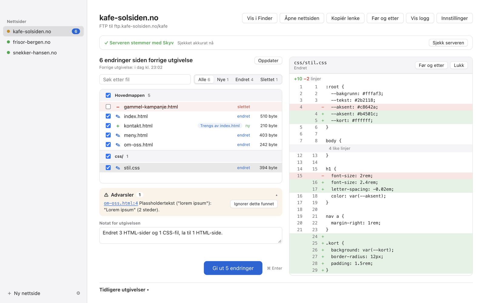
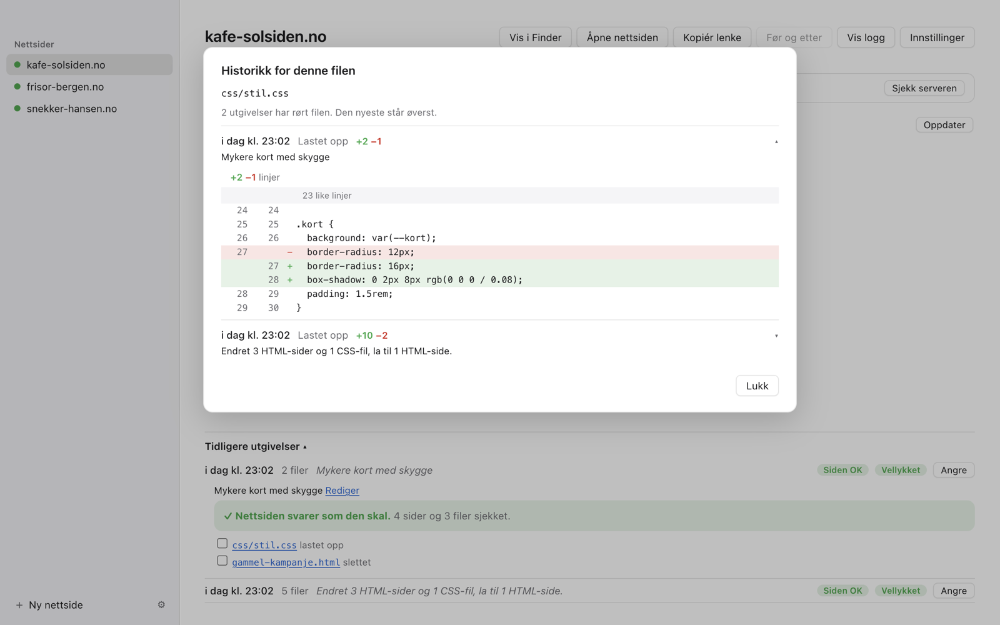
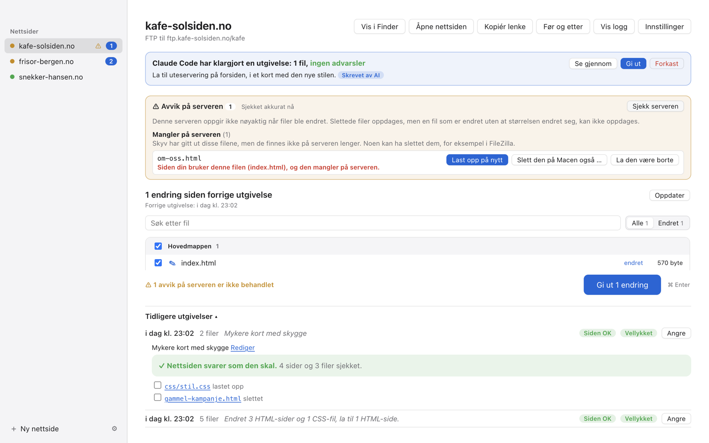
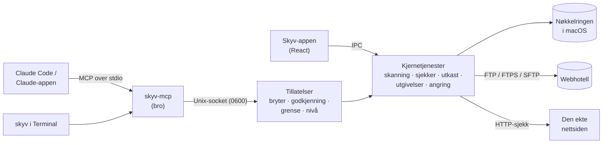

<div align="center">


# Skyv

**Gi ut endringer på nettsiden som utgivelser, ikke som filer.**

En Mac-app for FTP, FTPS og SFTP som sjekker endringene før de går ut, sjekker den ekte nettsiden etterpå, og lar deg angre en utgivelse med ett klikk.

[](https://github.com/PolsaFH/skyv/releases/latest)


[](LICENSE.md)

[**Last ned for Mac**](https://github.com/PolsaFH/skyv/releases/latest) &nbsp;·&nbsp; [Funksjoner](#funksjoner) &nbsp;·&nbsp; [AI-tilkobling](#jobb-trygt-med-ai) &nbsp;·&nbsp; [Arkitektur](#under-panseret) &nbsp;·&nbsp; [🇬🇧 English](README.md)

<br>



</div>

<br>

## Hvorfor Skyv

Vanlige FTP-programmer kopierer filer. Du må huske hva du har endret, ingenting hindrer deg i å overskrive noe andre har gjort, og det finnes ingen vei tilbake hvis siden slutter å virke.

Skyv ser på mappen på Macen som fasiten, og på webhotellet som stedet du *gir ut* til. Hver utgivelse blir sjekket, sikkerhetskopiert, kontrollert og kan angres.

Appen er laget for deg som lager nettsider (HTML, CSS, JavaScript eller PHP), gjerne sammen med en AI. Du får tryggheten fra en ordentlig utgivelsesprosess uten å måtte lære git.

<br>

## Funksjoner

### Se nøyaktig hva som blir endret
Skyv følger med på mappene dine og viser hva som er nytt, endret, slettet eller flyttet siden forrige utgivelse. Du ser forskjellen linje for linje i tekstfiler, og før og etter for bilder. Skyv finner også filene sidene dine trenger og tar dem med automatisk, så du aldri gir ut en side uten stilarket sitt.

### Fang feil før de når nettsiden
Hver utgivelse går gjennom en rekke sjekker. Alvorlige problemer stopper utgivelsen til du har rettet dem, eller bevisst velger å gi ut likevel.

| Sjekk | Hva den fanger |
|---|---|
| Hemmeligheter | API-nøkler, passord og private nøkler i koden |
| Sensitive filer | `.env`-filer, SSH-nøkler, sertifikater, databasekopier, sikkerhetskopier og arkiver som aldri skal være offentlige |
| Ødelagte lenker | Lenker til filer som vil mangle, og lenker til `localhost` eller adresser i det lokale nettet |
| PHP | Syntaksfeil, med PHP som er installert på Macen |
| Innhold | Glemt plassholdertekst som *lorem ipsum*, og ugyldig JSON |
| Konflikter | Filer som noen andre har endret på serveren siden forrige utgivelse |

### Gi ut trygt
- **Sikkerhetskopi først:** alle filer som blir overskrevet eller slettet, lastes ned før noe endres.
- **Ingen halvferdige filer:** filene lastes opp under et midlertidig navn og får riktig navn først når de er ferdige.
- **Rask og robust:** flere tilkoblinger samtidig, nye forsøk ved brudd, og trygg fortsettelse etter krasj eller strømbrudd.
- **Sletting skjer aldri av seg selv:** du må velge det hver gang.

### Sjekk den ekte nettsiden, og angre med ett klikk
Etter opplasting henter Skyv de berørte sidene fra den ekte nettadressen. Den sjekker at de svarer, at de ikke viser PHP-feil, og at bilder, CSS og JavaScript lastes. Er noe galt, kan du angre hele utgivelsen eller bare utvalgte filer. Du kan også la Skyv angre automatisk.

### Oppdag endringer på serveren
**Sjekk serveren** sammenligner serveren med det Skyv sist ga ut, og finner tre slags avvik:
- filer som **mangler** på serveren
- filer som er **endret** der
- filer som **bare finnes på serveren**

For hvert avvik får du tydelige valg: last opp på nytt, hent serverens versjon, behold din, eller la være. Alt som fjernes fra Macen, havner i Papirkurven og slettes aldri for godt.

### Historikk for hver fil
Hver utgivelse lagrer en kort forskjell for hver tekstfil. Åpne en fil og se når den ble endret, i hvilken utgivelse, med hvilket notat, og nøyaktig hva som ble endret.

<br>

<div align="center">

</div>

<br>

## Jobb trygt med AI

Skyv har en innebygd, lokal [MCP-server](https://modelcontextprotocol.io) (Model Context Protocol). Med den kan **Claude Code** eller **Claude-appen** se nettsidene dine, kjøre sjekkene, ta skjermbilder av sider og klargjøre utgivelser. Du trenger ingen API-nøkkel, og du har hele tiden kontrollen.

<div align="center">
<picture>
  <source media="(prefers-color-scheme: dark)" srcset="docs/images/ai-dark.png">
  
</picture>
</div>

<br>

- **Av som standard**, med en hovedbryter. Hvert nytt AI-program må godkjennes i appen.
- **Tre nivåer per nettside:** *Bare se*, *Se og klargjøre* eller *Se, klargjøre og gi ut*.
- **Utkast, ikke overraskelser:** AI-en klargjør en utgivelse med et notat. Den vises som et bånd i Skyv, merket *Skrevet av AI*, og du gir den ut med ett klikk.
- **Harde sperrer som AI-en ikke kan omgå**, heller ikke på det høyeste nivået:
  - alvorlige funn
  - konflikter på serveren
  - ubehandlede avvik på serveren
  - slettinger
  - filer som er endret etter at utkastet ble laget
- **Angrer aldri selv:** AI-en kan bare *be* deg angre en utgivelse.
- **Hemmeligheter forblir hemmelige:**
  - Passord sendes aldri til AI-en.
  - Linjer som ser ut som nøkler, skjules.
  - Alle svar vaskes for kjente passord.
  - Innhold fra filer og nettsider merkes som data, ikke instrukser, for å stå imot forsøk på å lure AI-en.
- **Lukker sløyfen:** feiler sjekken av nettsiden etter en AI-utgivelse, får AI-en vite hvilken side og fil, og hva feilen er. Da kan den rette feilen og klargjøre en ny utgivelse.

Én kommando kobler til Claude Code:

```bash
claude mcp add skyv -- /Applications/Skyv.app/Contents/Resources/bin/skyv-mcp
```

Spør for eksempel:
- *«Hva er endret i nettsiden?»*
- *«Kjør sjekkene og rett det du kan.»*
- *«Når ble stil.css sist endret?»*
- *«Klargjør en utgivelse med et kort notat.»*

Det finnes også en `skyv`-kommando for Terminal (`skyv status`, `skyv check`, `skyv prepare`), med de samme tillatelsene.

<br>

## Under panseret



**Slik går en utgivelse:**
1. skanning
2. finne filene sidene trenger
3. sjekker
4. sjekk av konflikter
5. sikkerhetskopi
6. opplasting under midlertidige navn
7. riktig navn på plass
8. sjekk av den ekte nettsiden
9. automatisk angring (valgfritt)

| | |
|---|---|
| **Teknologi** | Electron 45, React 19, TypeScript (strict), Vite, electron-vite |
| **Overføring** | `basic-ftp` (FTP/FTPS), `ssh2-sftp-client` (SFTP) |
| **AI** | `@modelcontextprotocol/sdk`, Zod-skjemaer, lokalt API over Unix-socket |
| **Lagring** | Atomisk skriving av JSON, innholdsadresserte kopier, passord kryptert med nøkkelringen i macOS |
| **Oppbygging** | Kjernen i `src/core` er ren TypeScript uten Electron. Appen, AI-tilkoblingen og kommandolinjen bruker de samme tjenestene, så de samme reglene gjelder overalt. |
| **Tester** | 274 tester med Vitest: enhetstester, integrasjonstester mot en lokal FTP-server, og ende-til-ende-tester som styrer den ekte appen med Playwright |
| **Ytelse** | 5000 filer: første skanning ca. 0,8 s, ny skanning ca. 0,55 s, sjekker før utgivelse ca. 0,4 s (Apple-prosessor) |

Mer om arkitektur, valg underveis og kjente begrensninger står i [`docs/UTVIKLING.md`](docs/UTVIKLING.md).

<br>

## Installere

1. Last ned `Skyv-<versjon>-arm64.dmg` (Apple-prosessor) eller `Skyv-<versjon>-x64.dmg` (Intel) fra [Releases](https://github.com/PolsaFH/skyv/releases/latest).
2. Åpne `.dmg`-filen og dra Skyv til **Programmer** (Applications).
3. Åpne Skyv og lukk advarselen. Appen er ikke godkjent av Apple.
4. Gå til **Systeminnstillinger → Personvern og sikkerhet** (System Settings → Privacy & Security) og trykk **Åpne likevel** (Open Anyway).

Valgfritt: installer PHP (`brew install php`) for sjekk av PHP-filer og lokal forhåndsvisning av PHP-sider.

### Bygge selv

```bash
npm install
npm run dev     # kjør i utvikling
npm test        # kjør testene
npm run dist    # bygg .dmg for Apple-prosessor og Intel
```

Krever Node 20 eller nyere.

<br>

## Personvern

Skyv har ingen konto, samler ingen bruksdata og har ingen egen server. Alt blir på Macen din:
- Oppsettet for nettsidene, historikken og sikkerhetskopiene ligger i `~/Library/Application Support/Skyv`.
- Passord er kryptert med nøkkelringen i macOS.
- AI-tilkoblingen er lokal og forblir av til du slår den på.

## Lisens

Copyright © 2026 Filip Hjelmeland.

Skyv er gratis for ikke-kommersiell bruk under [PolyForm Noncommercial License 1.0.0](LICENSE.md). Du kan bruke appen, og lese og endre koden til ikke-kommersielle formål. Kommersiell bruk krever skriftlig tillatelse. Appen leveres som den er, uten garanti.
